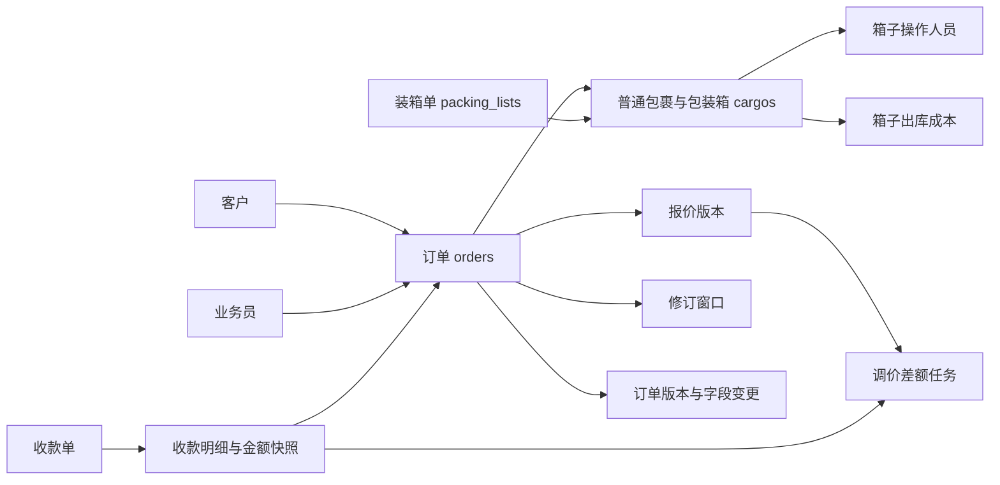
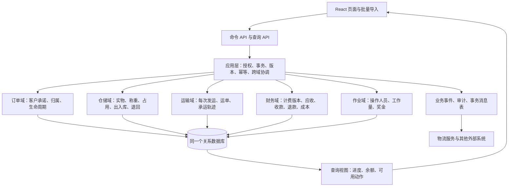
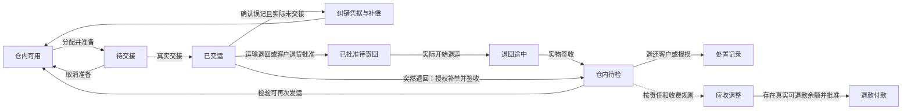

# 迅达货运系统架构与状态评审

评审日期：2026 年 9 月 30 日。范围：当前工作区中的 React 前端、Flask 后端、数据模型、迁移和相关测试，包含尚未提交的修改。本文是重构设计输入；本次未修改业务代码，未连接生产数据库。

## 一 结论

当前系统的主要问题是：同一个业务事实由多个字段和多个入口表达，状态转换的前置条件、权限和副作用没有统一执行。继续增加状态枚举或给管理员增加一个“强制修改状态”按钮，会进一步放大不一致。

建议保留现有技术栈，改造成有明确业务边界的模块化单体。订单、仓储、运输、财务分别维护自身状态，通过明确的业务动作和事务协作。订单页面展示这些状态的汇总，但不把它们合成一个越来越大的订单状态枚举。

本次已确认的重点：

1. **归档正在改变财务报表的有效数据范围。** 归档订单会级联归档报价、成本、差价和收款明细，应收台账随后排除这些记录。
2. **出库隐藏在普通字段更新中。** 单箱编辑、普通包裹编辑、批量导入运单的前置条件不同，能产生“无订单但已出库”等组合。
3. **状态保护不等于动作完备。** 已有撤销出库，但受永久财务锁限制；普通包裹、实际退回、退款、已审核收款纠错缺少完整处理路径。
4. **权限并非所有入口统一执行。** 前端不可见不代表后端不可调用；专用接口与通用接口对同一字段的授权不同。
5. **当前值、业务快照和历史报表混用。** 没有收据历史的订单改重，会改变此前日期的应收查询结果；负报价差额也被直接命名为退款任务。

用户已确认重构应覆盖三类逆向流程：**误操作撤销、运输退回仓库、客户退货退款**。

## 二 优先处理的发现

以下 P1 表示应优先修复的数据一致性或权限问题；P2 表示需纳入重构的语义、恢复能力或可维护性问题。“复现”指隔离内存数据库，不代表已在生产发生。

### F1 P1 归档订单会让应收与财务关联记录退出台账

**证据：** [级联归档实现](/Users/tony/wms/wms_backend/data/DB.py:442) 同时标记 Cargo、BoxCostRecord、OrderQuoteVersion、OrderPriceAdjustment、PaymentReceiptItem 的 `archive=True`；[订单归档入口](/Users/tony/wms/wms_backend/controllers/order_controller.py:555) 只要求有效登录，未限定角色或订单归属；[应收台账查询](/Users/tony/wms/wms_backend/services/receivable_service.py:1697) 排除归档报价、订单及收款明细。

**触发与影响：** 对存在报价、收款或未结清余额的订单调用归档，会让其从应收查询中消失，而原收款单本身未被正常冲正。[现有测试](/Users/tony/wms/wms_backend/tests/unit/test_order_business_lock_and_adjustments.py:132) 明确断言归档后应收、差价和报价审批列表为空，说明这是当前设计行为。

**建议：** 拆开归档、取消、财务冲正。归档只影响日常列表展示；财务查询仍按分录和业务有效时间计算。取消订单需要明确处理未履约部分；减少应收、退钱和撤销错误收款分别生成对应凭据。先收紧归档权限，再迁移语义，历史被归档的财务数据应先出差异清单，不能直接批量恢复。

### F2 P1 分配与解绑没有维护完整的仓储不变量

**证据：** [批量分配](/Users/tony/wms/wms_backend/data/packing/PackingList.py:1454) 检查订单存在、无收据历史、箱子未出库且未分配，却不检查订单/箱子/装箱单是否归档、装箱单是否完成或箱子是否称重。[可选箱查询](/Users/tony/wms/wms_backend/data/packing/PackingList.py:1536) 的筛选更严格，写入接口没有执行同样的条件。[批量解绑](/Users/tony/wms/wms_backend/data/DB.py:1415) 只检查收据历史，随后清空订单关联。

**已复现：**

- 草稿装箱单中的未称重箱可以分配给已归档订单。
- 已归档箱也可以分配。
- 无收据历史的已出库箱解绑后，`target_order_uid=None`、`status=1`、运单号仍存在，成本记录仍指向旧订单。旧订单业务锁变为 `none`，箱子再次分配却提示已经出库。

**建议：** 统一 `AssignPackage`、`UnassignPackage`、`TransferAssignment` 命令。出库后需要走撤销或退回流程，不能只删除关联。候选列表只是提示；命令执行时必须在事务内重新校验全部前置条件。

### F3 P1 普通更新隐式出库，多个入口执行不同规则

**证据：** [显式出库接口](/Users/tony/wms/wms_backend/controllers/packing_controller.py:739) 返回 410，要求通过记录运单号出库。[箱子更新](/Users/tony/wms/wms_backend/data/packing/PackingList.py:1080) 在已有订单关联时自动出库；[普通货物更新](/Users/tony/wms/wms_backend/data/DB.py:1250) 和[批量运单导入](/Users/tony/wms/wms_backend/services/cargo_service.py:436) 对未出库记录直接置 `status=1`。

**已复现：**

- 普通包裹重量为 0，录入运单后成为已出库；后续补重量被出库重量锁拒绝。清空运单也不回退状态，现有撤销出库又不支持普通包裹。
- 未分配箱通过单箱更新录入运单仍为未出库；之后分配订单、再次保存相同运单，仍未生成出库事实或成本。
- 同类未分配箱通过批量运单导入会成为已出库，但没有订单关联或成本记录。

**建议：** 分离 `RecordTrackingNumber` 与 `DispatchShipment`。界面仍可提供一次操作完成“录号并出库”，内部必须显式调用同一个出库命令。出库、成本记录、历史记录在同一事务提交；单个、批量、导入入口共享校验器。

### F4 P1 字段权限可通过另一个接口绕过

**证据：** [编辑策略](/Users/tony/wms/wms_backend/services/order_edit_policy.py:219) 不给 `clerk` 称重权限；[专用称重接口](/Users/tony/wms/wms_backend/controllers/packing_controller.py:507) 也限制称重角色。但[通用货物更新](/Users/tony/wms/wms_backend/controllers/cargo_controller.py:272) 允许 `clerk` 进入箱子更新分支，并接收 `weight`。模型内部只检查状态和财务锁，未执行操作者的字段权限。

此外，订单创建、普通修改、归档/删除等多个入口使用 `@allow()`；[装饰器实现](/Users/tony/wms/wms_backend/Auth.py:174) 在没有指定角色时不做角色校验。[前端订单列表](/Users/tony/wms/wms_frontend/src/pages/orderList.js:219) 的管理密码仅在客户端校验，无法成为后端权限边界。

**影响：** 文员可以绕过专用称重权限修改可编辑箱子的重量；没有前端菜单的登录角色仍可能调用普通订单写入接口。是否允许全部员工编辑所有订单，应成为显式业务授权规则。

**建议：** 所有命令接收操作者，统一校验“能力权限 + 对象归属 + 字段范围 + 当前状态”。`edit_policy` 和 `available_commands` 由同一策略生成，写入时重新执行；禁止只把策略作为前端按钮提示。

认证基础还需一起整改：当前角色从有效期七天的 JWT 读取，角色撤销、用户删除后旧令牌没有即时失效机制；[认证模块](/Users/tony/wms/wms_backend/Auth.py:11) 还在源码中保存签名密钥。应将密钥移到受控配置并轮换，增加会话撤销或权限版本校验；否则后续状态机即便正确，授权边界仍不可靠。

### F5 P1 历史应收报表会使用后续修改的重量

**证据：** [历史台账](/Users/tony/wms/wms_backend/services/receivable_service.py:1697) 按生效日期选择报价，但[金额计算](/Users/tony/wms/wms_backend/services/receivable_service.py:1772) 调用 `quote_pricing_state`；[该函数](/Users/tony/wms/wms_backend/services/receivable_service.py:113) 对当前有效报价采用当前包裹重量。

**已复现：** 无收据历史订单在 2026-09-04 的有效报价为每公斤 12，10.5kg 按当前进位规则计费为 132。通过真实 `cargo_model.update` 改为 20.5kg 后，查询同一历史日期，金额变为 252。生成并审核收据后再改重会被锁拒绝，因此此发现特指尚无收据历史时的历史查询。

**建议：** 分开“按当前重量估算”与“截至某日已确认应收”。历史财务查询只读已确认计费版本和分录；修正重量产生新计费版本/差额，不能让历史查询隐式重算。保留业务生效时间和系统记录时间，并明确迟录业务如何影响历史报表。

### F6 P2 应收调减与现金退款混为一谈，退款没有完成路径

**证据：** [调价任务生成](/Users/tony/wms/wms_backend/services/receivable_service.py:705) 只按新旧应收差额的正负设置 `collect/refund`，没有据此判断实际可退款余额。[财务接口](/Users/tony/wms/wms_backend/controllers/receivable_controller.py:55) 提供差价查询、收款创建与审核，但没有退款执行/退款冲正流程；[现有测试](/Users/tony/wms/wms_backend/tests/unit/test_price_adjustment_collection.py:244) 明确退款任务保持只读。

**已复现：** 原应收 132、已收 10，改价后应收 121，真实结果是还欠 111；系统同时生成 `refund/-11/pending` 的任务，而账本 `refund_due=0`。应收减少 11 并不代表应付现金退款 11。

**建议：** 先生成应收调减凭据，再按实际已收、已退款、核销与其他调整计算余额。超收金额可以退款或留作客户余额；退款必须有独立申请、审批、付款确认、失败重试与冲正记录。不能直接对负差价单点击“退款完成”。

### F7 P2 永久锁保护了旧记录，却没有对应的纠错动作

**证据：** [收据历史判断](/Users/tony/wms/wms_backend/data/DB.py:1722) 只检查是否存在明细，包括后续被拒绝的收据。[编辑策略](/Users/tony/wms/wms_backend/services/order_edit_policy.py:88) 永久阻止改重、换客户、改箱子成员；[撤销出库](/Users/tony/wms/wms_backend/data/packing/PackingList.py:1704) 也被收据历史阻止。管理员开启修订只解除部分业务编辑限制，不解除上述条件。

现有撤销动作只支持装箱单箱子，会清空运单、回退状态并删除成本记录。已审核收据没有对应的撤销/冲正命令。实际退回及重新发货也缺少独立业务单据。

**建议：** 保留不可变历史，但增加“更正计费基础”“冲正错误收款”“接收退回”“再次发运”等新事实。对被拒绝的收据释放占用是否也应解除当前编辑限制，需要明确业务政策；保留被拒绝凭据自身的历史不要求永久冻结实物数据。

### F8 P2 状态域、展示规则和历史口径分散

**证据：** [装箱单更新](/Users/tony/wms/wms_backend/data/packing/PackingList.py:394) 直接接收任意非空 `status`，隔离复现可持久化 `BANANA`。[装箱单列表](/Users/tony/wms/wms_frontend/src/pages/packingListList.js:52)、[详情](/Users/tony/wms/wms_frontend/src/pages/packingListDetail.js:95) 和[后端展示函数](/Users/tony/wms/wms_backend/services/packing_list_service.py:93) 分别计算展示状态；混合进度按最低进度显示。普通包裹查询还会在响应中把 `status` 替换为物流子状态，见[物流查询](/Users/tony/wms/wms_backend/services/cargo_service.py:168)。

**建议：** 为每个状态字段限定合法取值，并只允许命令转换。库存状态与物流追踪状态分别返回；装箱单显示已分配、已出库、退回的数量。保留旧字段作为兼容投影，逐步消除前端独立推导。

### F9 P2 审核并发与审计事务仍有缺口

**并发风险，尚未进行 MySQL 实测：** [报价审核](/Users/tony/wms/wms_backend/controllers/order_controller.py:801) 先读 `pending`；批准分支再锁订单和报价并重读，拒绝分支直接写入。并发批准/拒绝可能让后到的陈旧拒绝覆盖审批结果。SQLAlchemy 的脏字段行为还可能使数据库保留另一事务已写入的部分字段。应让两条分支统一锁定并重新校验状态，或使用条件更新和受影响行数。

**已确认的审计设计：** [操作日志](/Users/tony/wms/wms_backend/utils/log.py:63) 在执行业务前独立提交；[财务审计](/Users/tony/wms/wms_backend/utils/audit.py:54) 使用独立事务且吞掉异常；[收款控制器](/Users/tony/wms/wms_backend/controllers/receivable_controller.py:94) 在业务服务提交后写审计。因此请求日志不能证明业务成功，财务变更也不保证必有审计记录。

**建议：** 成功的业务事件与业务记录同事务保存，请求日志额外记录结果；外部物流注册通过事务消息表可靠重试。已有订单版本与业务变更同事务的设计值得保留。

## 三 当前系统的实际结构

### 3.1 功能地图

| 业务模块 | 已有功能 | 主要实现 |
| --- | --- | --- |
| 用户与权限 | 注册审批、多角色、人员管理、密码重置 | `Auth.py`、auth controller/service、user/role models、admin 页面 |
| 订单 | 新建/导入、客户与业务员关联、地址、包裹成员、归档删除、修订窗口、版本历史 | order controller、`OrderModel`、order_edit_policy、order_version、orderList/orderDetail |
| 仓储与打包 | 装箱单、唛头、照片、箱内明细、称重、操作人员、分配/解绑、录号出库、部分撤销 | packing/cargo controllers、`PackingListModel`、`BoxModel`、`CargoModel` |
| 运输与单证 | 运输渠道、转单与运单、17Track、Excel 导入导出、PDF 与面单模板 | cargo_service、运输/模板控制器、工具模块、ExportButton |
| 报价与成本 | 渠道成本版本、低价审核、报价版本、有效报价、出库成本 | receivable_service、order controller、financeCenter/costManagement |
| 收款与应收 | 收据、审批、结清差额、应收台账、调价补收 | receivable_service/controller、receipts/financeReceivables |
| 工作量与奖金 | 打包人员、奖金项目、分配标记、工人/业务员奖金估算 | work_finance_service、BonusItem/Rate、workDetails/bonusEstimate |
| 主数据与审计 | 客户/收件人、品名、海关编码、模板、操作日志、财务审计 | customer 与配置控制器、utils/log、utils/audit |

现有文档描述的是控制器—服务—数据三层，实际业务规则跨越这些层：`order_service.py` 主要负责列表处理，核心订单规则在 `data/DB.py`；报价审批又直接位于控制器；装箱单模型还承担出库、成本和版本记录。默认数据库连接实际是 MySQL，仓库说明中的 SQLite 描述已经过时；测试大量使用 SQLite。

前端的订单详情、装箱单详情、管理员页各超过 1,600 行，后端 `DB.py` 与 `receivable_service.py` 各接近 2,000 行。体积体现了职责聚集，但仅拆文件不能解决状态与授权分叉。

### 3.2 核心实体关系



重要区别：`BoxTable` 是 `CargoTable` 的别名；通过 `packing_list_uid` 是否为空区分普通包裹与装箱单箱子。它们共享存储，却经过不同写入路径。现有库存主要是包裹/箱级管理，未发现独立的库存移动账、发运批次和退货单模型；箱内品名明细不能直接替代商品级库存。

### 3.3 系统维护的状态清单

| 对象/维度 | 当前存储或推导 | 现有值与含义 | 关键问题 |
| --- | --- | --- | --- |
| 订单生命周期 | `Order.archive` | 活跃/归档 | 没有独立确认、取消、关闭生命周期；归档承担过多语义 |
| 订单全部出库 | `order_fully_outbound` 推导 | 活跃装箱单箱子全部 `status=1` 且有运单 | 排除普通包裹，无箱时为 false |
| 订单业务锁 | 推导 + 修订记录 | `none / locked / revision_open` | 开放修订优先；这是一种编辑控制，不是订单履约状态 |
| 财务基础锁 | 是否存在任何收款明细 | true/false | 包括拒绝单；与业务锁独立 |
| 修订窗口 | `OrderReceiptRevision.status` | `open / closed` | 原名与收据相关，当前主要表达业务修订 |
| 装箱单 | `PackingList.status` | 约定 `draft / completed` | 泛型更新不验证枚举和转换 |
| 箱子订单分配 | `target_order_uid` | 无关联/已分配 | 与出库标记不保证一致 |
| 包裹/箱子出库 | `Cargo.status` | 主要为 `0 / 1` | 表示未出库/已出库；缺少退回和多次发运 |
| 包装箱旧状态 | `Cargo.box_status` | 默认 `pending`，仍被部分读取 | 当前主流程未发现完整维护动作，不宜作为权威状态 |
| 物流追踪 | `track_status`；普通包裹响应的 `status` | 第三方子状态 | 运输信息与库存事实混用响应字段 |
| 装箱单展示 | 根据箱子最低进度推导 | 草稿/待分配/待出库/已出库 | 混合、部分完成情况被压缩 |
| 报价审核 | `Quote.status` | `adopted / pending / approved / rejected` | 高于底价自动 adopted；低价 pending，管理员审核 |
| 当前有效报价 | `Quote.is_final` + 状态 + 未归档 | 当前版本/历史版本；生效日用于历史查询 | 多字段共同表达有效性，必须保持一致 |
| 调价任务 | `direction + status` | `collect / refund`；实际主要 `pending / resolved` | 查询接受 cancelled，但未发现完整取消命令；退款无关闭流程 |
| 收款审核 | `Receipt.status` | `pending / approved / rejected` | 终态缺少冲正；拒绝后可以重新录单 |
| 收款结清选择 | `Receipt.settlement_status` | `settled / unsettled`，旧数据可空 | 单据结清决定，不等于订单余额状态 |
| 订单应收汇总 | 报价、已审收款、结清差额推导 | `unpaid / partial / paid / refund_due` | 历史查询混用当前货重 |
| 奖金 | `bonus_assigned`、项目和人员关联 | 未分配/已分配 | 分配标记不等于已审核、已入账或已支付 |
| 归档 | 多个表各自 `archive` | true/false | 有的控制可见性，有的改变财务统计范围 |

### 3.4 已有动作与缺口

| 范围 | 已有动作 | 缺少或语义不完整的动作 |
| --- | --- | --- |
| 订单 | 创建、编辑、加包裹、归档/删除、开关修订、查看版本 | 明确确认/取消/关闭、带补偿的纠错、保留财务有效性的归档 |
| 装箱单 | 创建、补箱、编辑、完成、归档/删除 | 受控重开、取消，以及合法转换校验 |
| 包裹/箱子 | 称重、分配、解绑、改号、录号自动出库 | 统一出库、普通包裹撤销、退回接收、检验、再次发运、部分退货 |
| 出库撤销 | 仅装箱单箱子支持，admin/store_manager | 有财务历史时的补偿；多次出库成本留痕 |
| 报价 | 报价、低价批准/拒绝、新版本替换有效报价 | 明确撤回/失效规则、报价与已确认应收的边界 |
| 收款 | 提交、批准、拒绝、部分收款、补差 | 审核后冲正、分配更正、退款、重复请求幂等凭据 |
| 奖金 | 规则配置、箱子分配、估算 | 若用于实际结算，需审核、确认、支付与调整凭据 |

已有基础应保留：集中编辑策略、Decimal 应收金额、收款金额快照、订单增量版本、部分行锁、事务回滚测试，以及真实 MySQL 并发测试的独立入口。这些能力应收敛到统一的动作执行流程。

## 四 目标架构

### 4.1 业务边界



第一阶段保持单应用、单数据库。跨域强一致动作使用本地数据库事务；17Track 等外部动作提交后由事务消息表驱动重试。无需先引入微服务、消息集群或通用可视化流程引擎。

### 4.2 每个模块拥有的事实

| 模块 | 唯一负责的事实 | 对其他模块提供什么 |
| --- | --- | --- |
| 订单 | 客户、业务员、服务要求、订单确认/取消/关闭 | 订单有效性、授权范围、允许履约的内容 |
| 仓储 | 包裹身份、实测重量版本、仓内位置/保管状态、可用性、分配与移动记录 | 哪些实物可以发运、哪些已重新入仓 |
| 运输 | 每一次发运及明细、运单、交接事实、承运状态 | 发运/交接/退回运输信息 |
| 计费与财务 | 已确认计费基础、应收调整、现金收付及分配、核销、成本 | 欠款、超收、可退款余额、财务限制原因 |
| 作业与奖金 | 谁完成了哪项工作、采用的规则版本、确认的奖金 | 成本或奖金分录、人员工作量 |
| 审计与权限 | 谁在什么权限下执行了什么动作、前后版本和原因 | 可解释的允许/拒绝结果及追溯 |

必要耦合通过命令前置条件与业务凭据明确表达。例如退回入仓影响实物位置；是否减收、退运费、扣手续费由后续财务动作决定。退款完成不会把实物自动改成已入仓。

### 4.3 最小数据模型演进

建议优先增加以下概念，物理表可分阶段建立：

- `Package`：统一普通包裹和包装箱的实物身份。初期可继续使用 `cargos` 表，通过显式类型和同一服务管理；不必立刻拆成两套实体。
- `PackageAssignment`：订单分配的有效区间与历史；同一实物最多一个有效分配。当前 `target_order_uid` 可暂作当前关联投影。
- `Shipment`、`ShipmentItem`：一次发运和本次发运实物。运单、出库重量、订单归属、渠道与成本基础绑定到这次发运。
- `InventoryMovement`：接收、发出、退回、报损、纠错等移动事实；引用来源单据与原事件。
- `ReturnOrder`、`ReturnItem`：区分运输退回与客户退货，关联原发运明细，记录数量、原因、接收与检验结果。
- `BillingVersion` / `Charge`：已确认计费基础。报价可以是估算，进入应收的版本必须固定。
- `ReceivableAdjustment`：应收增加/减少，与现金退款分开。
- `Payment`、`PaymentAllocation`、`Refund`：资金收付及其订单/账单分配；冲正引用原单据。
- `CostEntry`、`BonusAccrual`：已确认成本和奖金；纠错新增调整，不删除原始事实。
- `BusinessEvent`、`CommandExecution`：操作者、原因、版本、幂等键、关联动作，以及必要的待发送事件。

包裹第一次出库、退回、第二次出库使用同一个实物 ID，但有不同的发运明细与成本记录。订单版本历史继续保留，作为业务事件关联的详细差异；不需要把全系统重写成事件溯源系统。

## 五 状态机与动作设计

### 5.1 状态按维度拆分

以下是建议模型，需在重构时冻结准确业务语义。

| 对象/维度 | 建议状态 | 状态来源 |
| --- | --- | --- |
| 订单生命周期 | 草稿、已确认、已取消、已关闭 | 部分取消记录在明细数量上；全部取消且无真实履约时才为已取消 |
| 订单履约进度 | 待发数量、有效发运数量、退回数量、待处理异常 | 从发运、退回及分配汇总；可附简短标签 |
| 包裹保管状态 | 预期到货、仓内、已交运、退回途中 | 仓储/交接动作 |
| 包裹分配 | 未分配、已分配 | 有效分配关系 |
| 包裹可用性 | 可用、待检、冻结、损坏、已处置 | 检验、冻结/解除、处置动作 |
| 装箱单 | 草稿、已完成、已取消 | 完成、重开、取消；履约进度独立展示 |
| 发运单 | 草稿、待交接、已交接、已关闭、已撤销 | 组单、确认交接、关闭、误操作撤销 |
| 退货单 | 申请、已批准待寄回、退回途中、已接收、已关闭、已拒绝/取消 | 审批与实际退运分开；部分接收由明细数量表达 |
| 报价 | 草稿、待审、有效、已拒绝、已替代/撤回 | 生效与审批规则；历史版本保留 |
| 计费凭据 | 草稿、已确认、已冲正 | 确认、反向调整；余额派生 |
| 收款凭据 | 待审核、已确认、已拒绝、已冲正 | 审核与冲正；资金事实和核销分配分别记录 |
| 退款凭据 | 待审核、已批准、已付款、失败、已取消 | 实际付款确认；已付款后的纠错另留记录 |
| 修订/纠错 | 草稿、待批准、执行中、已完成、失败、已取消 | 明确对象、字段、执行人、期限和补偿步骤 |

“全部已发”“部分退回”“尚欠款”可以同时成立。展示时分别显示履约进度和财务余额，避免强行选择其中一个作为唯一订单状态。

### 5.2 三类逆向流程



**误操作撤销：** 系统记了出库，但实际未交接。命令引用错误发运，保留原记录，追加纠正库存和成本的凭据。如果已经产生已确认财务后果，同时生成或执行明确的财务补偿。

**运输退回仓库：** 原出库确实发生，不能撤销这个事实。登记退回原因与原发运，实际到仓后记退回入库和检验。承运商突然退回时，允许授权人员同事务补建退回单并签收；原发运暂时无法确认的，先登记待查收货并冻结，不自动退款。再次发货创建新发运及新运单；原运费是否保留、退回费由谁承担独立处理。

**客户退货退款：** 退货申请、审批、实物接收、检验、应收调减、退款审批和实际付款分别记录。允许经授权的部分退货、部分退款、先退款后到货等策略，但必须各自留凭据，不能依赖一个 `returned` 状态同时代表全部完成。

第一版建议至少实现整箱/整包裹退回。箱内部分商品退货若要支持，需要明细身份和数量守恒；不能只修改箱子 `piece_count` 来冒充部分退货账。

### 5.3 核心动作矩阵

| 动作 | 主要前置条件 | 状态/事实变化 | 失败、撤销或后续处理 |
| --- | --- | --- | --- |
| 确认订单 | 客户、服务要求与必需信息齐全 | 草稿变为已确认 | 变更或取消未履约部分 |
| 取消订单或未履约明细 | 未履约数量明确、操作者有权限 | 释放未发分配，记录取消数量及必要应收调整 | 部分取消仍为已确认；全部取消且无履约才为已取消 |
| 接收入仓 | 实物标识明确、未重复签收 | 仓内、接收记录 | 错收更正凭据 |
| 称重 | 在仓且有称重权限 | 新测量值/测量版本 | 已计费则更正计费版本，旧值留存 |
| 完成装箱 | 必需字段和重量齐全 | 装箱单完成 | 受控重开；已发部分受保护 |
| 分配订单 | 订单有效、箱子可用、未重复分配 | 有效关联 | 未发运可解绑/改分配 |
| 准备发运 | 分配、渠道、重量、单据满足规则 | 发运草稿/待交接 | 可取消准备 |
| 确认出库 | 实际交接、无冻结、版本匹配 | 发运事实、库存减少、成本凭据 | 实际未交接走误操作纠正；实际交接走退回 |
| 修正运单 | 有权限且明确目标发运 | 新运单版本、追踪注册任务 | 保留旧号和有效时间；不隐式再次出库 |
| 误出库纠正 | 原动作、理由、实际保管情况可验证 | 库存补偿、成本调整 | 多步过程失败可恢复；不删除原单 |
| 申请/批准退回 | 原发运与可退数量存在 | 退货单 | 拒绝/取消；已接收部分不能抹除 |
| 登记实际退运 | 已授权退回，存在实际寄回或承运确认 | 待寄回变为退回途中 | 物流信息更正，保留原轨迹 |
| 接收退回 | 对应退货单或授权补建，未超退或重复签收 | 仓内待检、退回移动；来源不明则待查 | 签收数量纠错、来源核对 |
| 检验/处置 | 已接收的实物 | 可用、冻结、损坏或处置 | 检验更正必须追溯 |
| 再次发运 | 可用且重新授权 | 新 ShipmentItem、新成本 | 新一轮独立撤销/退回 |
| 报价/审批 | 角色、订单归属、价格规则满足 | 新报价版本 | 撤回、拒绝、替代 |
| 确认应收 | 计费基础及生效日期明确 | 固定金额凭据 | 借记/贷记调整或冲正 |
| 更正计费基础或错误客户归属 | 高权限、原凭据、原因、影响范围与审批完整 | 新基础版本、必要应收调整或资金分配更正 | 原实物、原发运、原收款及其归属历史保留 |
| 录入/审核收款 | 收款事实、币种、金额、分配合法 | 已收资金与应收分配 | 审前拒绝；审后冲正或更正分配 |
| 申请/支付退款 | 实际可退款余额、审批和付款凭证 | 退款资金事实 | 失败重试；防重复付款 |
| 关闭/重开订单 | 未结事项已处理或有批准的例外 | 生命周期变更 | 高权限带原因重开，历史保留 |
| 归档/恢复展示 | 有权限 | 日常可见性 | 不改变库存和财务事实 |

状态机完备应理解为：每个受支持的状态与动作组合都明确“允许、拒绝原因、效果、失败恢复和后续动作”。不是任意两种状态都必须可以直接跳转；有真实发运的记录不能被任意改成“从未出库”。

## 六 财务与仓储如何耦合

### 6.1 用明确凭据连接，避免多个状态字段互相赋值

1. 出库形成发运和成本事实；是否确认收入/应收由明确的计费策略决定。
2. 退回入库增加仓内实物；是否减少原运费、增加退回费由合同和责任规则决定。
3. 应收调减改变客户应付金额；只有计算出超收并完成审批，才形成可支付退款。
4. 收款批准影响实收与核销；不改变包裹位置。
5. 原事实不可覆盖。纠错、冲正、再次发运各自引用原凭据，组成可追溯链。

不要把“已收款才能出库”硬编码为所有订单的规则。若业务存在现结/月结/授信，应使用客户结算策略、额度和人工放行权限；是否采用这些政策需业务确认。

### 6.2 金额模型

建议以最小的应收子账表达，不必第一阶段实现完整总账：

```text
净应收 = 原确认应收 + 调增 - 调减 - 已批准减免
有效收款 = 收款正向分录 + 收款冲正的负向分录
有效退款 = 退款正向分录 + 退款冲正的负向分录
净收款 = 有效收款 - 有效退款
余额   = 净应收 - 净收款
应收未收 = max(余额, 0)
超收余额 = max(-余额, 0)
可新增退款占用 = max(超收余额 - 有效未支付退款占用, 0)
```

以上同一订单、同一币种下计算。正向原单据保留，通过关联反向分录冲正，不能先排除原单再扣一次冲正。建议在退款申请提交时建立占用，拒绝或取消时释放，付款时消耗；付款失败但准备重试时继续保留。待审核收款与退款占用都不计入已发生现金。跨订单客户余额、跨币种与转账分配需单独规则。

示例：原应收 1,000，已收 800，退货调减 300，净应收 700，超收 100，最多按政策申请退款 100。若此前只收了 200，则还应收 500，不应生成现金退款 300。

若原收费已减免 20，后来重新报价，必须明确调整的是原确认收费还是未结余额，防止同时重复减免和调减。当前 `settlement_difference` 应迁移为有来源的减免/核销事实。

### 6.3 必须始终成立的不变量

- 同一实物同一时刻最多一个有效仓储位置和有效订单分配。
- 出库必须引用具体发运明细；再次发运产生新的明细。
- 有效退回数量不能超过对应原发运的剩余可退数量。
- 包裹归属变更不能使历史成本、收款和原发运悄悄改属其他订单。
- 每个计费范围最多一个当前有效版本；历史版本仍可读取。
- 已确认收款分配之和不能超过资金金额；超额部分应成为未分配余额。
- 新退款申请不能超过可新增退款占用；付款消耗原占用，同一退款不得重复付款。
- 所有已确认金额固定使用 Decimal/Numeric，旧 Float 成本逐步迁移并明确舍入规则。
- 审计成功事件与业务变更同事务；归档不得改变财务有效性。
- 管理员可以更正事实，但不能绕开金额守恒、数量守恒和原始记录留存。

## 七 权限与管理员纠错

### 7.1 授权表达

采用“角色授予能力，能力受对象和状态限制”：

```text
允许执行 = 用户仍有效
         AND 拥有该动作能力
         AND 满足对象范围（本人订单、所属仓库等）
         AND 满足字段和状态约束
         AND 满足金额/数量与审批规则
```

角色可以叠加，但字段授权、订单归属不能因拥有任意一个角色就全部放行。撤销角色或停用用户，应在后续命令时生效；当前 JWT 仅验证签名、过期时间和 token 内角色，默认有效期七天，见 [Auth.py](/Users/tony/wms/wms_backend/Auth.py:95)。

### 7.2 建议的能力分配

此表为重构起点，具体岗位边界应在开发前确认。

| 动作能力 | 操作工 | 文员 | 业务员 | 仓库主管 | 财务 | 系统管理员 |
| --- | --- | --- | --- | --- | --- | --- |
| 接收、打包、称重 | 授权作业范围 | 默认不称重 | 可按业务授权 | 可执行/复核 | 查看 | 配置并执行 |
| 订单资料、运单录入 | 有限字段 | 有限字段 | 本人订单 | 仓储相关字段 | 财务相关查询 | 全范围受控编辑 |
| 分配、交接出库、退回接收 | 按专门能力 | 按专门能力 | 本人订单申请 | 执行/批准 | 查看 | 执行/纠错 |
| 报价、退款申请 | 无 | 默认无 | 本人订单 | 默认无 | 财务申请或复核 | 全范围 |
| 收款审核、退款付款、财务冲正 | 无 | 无 | 默认无 | 无 | 可执行/复核 | 可执行，保留完整审计 |
| 历史纠错、重开、特殊放行 | 无 | 无 | 可申请 | 仓储范围 | 财务范围 | 发起或批准完整补偿计划 |

如需双人复核，检查申请人与审核人，而不仅检查角色。即使一个用户同时拥有业务员和财务角色，也不能自动绕过已选定的双人规则。

### 7.3 管理员的灵活性应落实成可审阅的纠错计划

管理员选择“将误出库箱恢复到仓内”时，系统先列出影响：原发运、库存、成本、计费基础、已收款、奖金、第三方物流。随后产生明确步骤，例如：

1. 记录纠错原因、证据与操作者。
2. 验证实物实际在仓，以及原发运是否已真实交接。
3. 追加撤销或退回移动记录，并更新当前仓储投影。
4. 成本、应收及奖金需要变化时追加对应调整。
5. 生成新版本；外部物流变更进入可靠重试队列。

普通用户受到动作与范围限制；最高权限可以组织完整的纠正过程。管理员也不能只把三个状态分别改成看起来一致的值。

同样应提供“更正已确认计费重量”“更正错误客户归属”“更正资金分配”命令。它们建立新的正确版本和必要的借记/贷记或核销更正，原发运及原收款仍可追溯。物理测量错误与收费约定调整分别记录，不能只改箱子重量来代替财务纠错。

修订窗口还应增加执行范围、允许字段、责任人、开启原因和结束条件。当前窗口开启后，满足常规写接口权限的用户仍能修改被放开的字段；应明确是否只允许指定修订人。

## 八 动作执行与前后端职责

### 8.1 后端统一执行命令

建议每个命令具有固定契约：动作名、对象、参数、所需能力、前置条件、事务内效果、事件、补偿方式与幂等规则。

```json
{
  "command": "receive_return",
  "return_id": "R-1001",
  "items": [{"shipment_item_id": "S-1", "package_id": "P-1", "quantity": 1}],
  "expected_version": 7,
  "idempotency_key": "client-generated-unique-key",
  "reason": "承运商退回并已实际签收"
}
```

执行顺序：

1. 认证当前用户及有效权限，解析命令参数。
2. 按固定顺序锁定相关订单、包裹、财务凭据；校验 `expected_version`。
3. 使用同一个策略检查能力、对象范围和当前状态。
4. 验证数量/金额不变量，执行领域动作。
5. 同事务保存业务数据、变更版本、成功事件和待发送任务。
6. 提交后执行外部副作用；失败按原幂等键重试。

保留订单历史版本号用于追溯，并补充写入时的版本校验，防止旧页面覆盖新操作。幂等键与请求内容摘要一起保存，同一键不同内容应拒绝。

批量命令必须声明整体成功还是逐项成功。出库、退款等关联动作一般按一张单据保持原子性；大批导入可逐单处理，并返回每单结果。不能在一个响应里含糊混用两种语义。

### 8.2 前端展示后端已解释的状态

后端返回独立的业务状态和能力信息，例如：

```json
{
  "lifecycle": "confirmed",
  "fulfillment": {"waiting": 2, "dispatched": 8, "returned": 1},
  "finance": {"outstanding": "100.00", "refund_due": "0.00"},
  "available_commands": [
    {"name": "receive_return", "enabled": true},
    {"name": "edit_billed_weight", "enabled": false,
     "reason_code": "BILLING_POSTED", "message": "请创建计费更正"}
  ],
  "version": 7
}
```

数量字段是独立指标，不要求相加等于订单箱数；需要明确哪些是当前数量、哪些是累计数量。订单页面可以同时展示履约、运输、财务和异常处理，不再各页面复制状态优先级。

后端可用动作列表用于解释与引导，真正执行时必须重新检查。前端保留输入格式校验，避免复刻业务守卫；按钮、导入和扫码调用相同命令。

### 8.3 建议代码布局

```text
backend/
  api/                   # HTTP 解析、响应、兼容旧接口
  application/           # 用例、事务、跨域协调
  domains/
    orders/
    warehouse/
    shipments/
    billing/
    payments/
    workforce/
  policies/              # 能力、对象范围、统一状态守卫
  infrastructure/        # ORM 仓储实现、外部物流、消息投递
  queries/               # 列表、状态汇总、历史台账
  audit/                 # 业务事件、版本、纠错关联
```

先迁移一个完整动作，再逐步搬动相关代码。旧 controller 和 model 可以暂时作为适配层调用新服务，避免重构期间出现两套权威写入路径。

## 九 分阶段重构路线

| 阶段 | 交付内容 | 验收条件 |
| --- | --- | --- |
| 0 建立基线 | 状态与动作目录、当前行为测试、异常数据只读扫描、业务语义确认 | 已知例外可枚举，财务基线可对账 |
| 1 收敛写入口 | 统一分配/解绑/录号/出库、字段权限、状态枚举、报价审核锁；隔离归档影响 | 普通编辑、专用接口、批量导入得到一致结果；禁止组合不可写入 |
| 2 建立发运与移动事实 | 发运明细、实物移动、出库纠正、运输退回接收、再次发运 | 一箱多次发运可追溯；普通包裹与装箱单箱子走同一规则 |
| 3 完成财务逆向流程 | 固定计费版本、应收调增/调减、收款冲正、退款及成本调整 | 已收/未收/部分收款退货均可闭环；历史报表稳定可解释 |
| 4 完成管理与前端迁移 | 管理员纠错工作台、统一可用动作、页面拆分、旧接口退出 | 修复异常有受控路径；无依赖旧字段写入的入口 |
| 5 持续收敛 | 奖金确认快照、真实数据库并发与恢复验证、去除无效状态和旧页面 | 关账后金额不漂移；重试和故障恢复通过验收 |

### 数据迁移原则

- 保留原 UID、运单、报价和收据标识，通过映射关联新对象。
- 从现有已出库记录建立历史发运基线，标记为历史导入；缺失的交接证据、成本和时间不能编造。
- `status=1` 无订单、零重量、重复关联、财务归档等异常进入人工待处理清单，不直接“自动修平”。
- 新旧查询并行比对数量、成本、应收、实收和历史截止日结果；先解释差异再切换。
- 切换按动作进行；同一动作只能有一个权威写入服务。兼容写入也必须委托给它。
- 旧字段成为只读投影后再删除。回退方案需保留迁移映射和兼容读取，不删除已创建的新历史凭据。

### 必须覆盖的验收场景

1. 草稿、未称重、归档、重复分配的箱子不能绕过接口守卫。
2. 无权限角色不能通过通用更新、导入或批量接口完成受限动作。
3. 零重量包裹误录运单可以受控纠正；录号本身不会隐式改变库存。
4. 部分发运、部分退回、退回再发运的数量与成本保持一致。
5. 未收款、部分收款、全额收款订单分别退货，得到正确的欠款/超收与退款。
6. 应收调减但客户仍欠款时不产生现金退款义务。
7. 收据被拒绝、收据已审核后发现错误，各自有明确恢复动作。
8. 重复点击、超时重试、同时批准/拒绝、并发退款不会重复记账。
9. 管理员纠错后可以追溯原操作、理由、关联补偿与前后版本。
10. 归档、后续改重、重新报价不隐式改变已确认历史账面事实。
11. 任一步骤失败，事务回滚；外部物流失败可单独重试，不丢失已提交业务事件。

## 十 验证结果与范围限制

### 本次执行的验证

- 静态追踪了当前核心模型、控制器、服务、页面、权限配置和相关测试；没有依赖旧文档推断当前行为。
- 使用内存 SQLite 构造合成数据，复现了非法分配、出库后解绑、普通包裹重量锁死、不同录号入口分叉、非法装箱单状态、历史金额漂移，以及应收调减被标成退款任务。
- 后端重点运行七组现有测试，共 **123 项：122 通过，1 失败**。覆盖业务锁与调价、收据修订、下游保护、差价补收、订单版本、出库重量锁、收款结清。
- 失败项为 [运单 A 到 B 到 C 的版本差异测试](/Users/tony/wms/wms_backend/tests/unit/test_order_versions.py:230)。历史重建及版本数量断言通过，但测试预期仅变更运单号；当前实现同时自动更新出库状态和时间，导致字段差异断言失败。它暴露的是当前自动出库行为与原测试约定不同，不能单凭这一失败断言版本恢复功能已损坏。
- 前端运行 `orderEditPolicy`、`packingListDetailEditPolicy`、`orderDetailWeightLock`、`receiptsAdjustments`，**4 组、20 项全部通过**。有 React/Ant Design 等现有测试警告。
- 后端测试在内存数据库执行，并替换应用启动的备份/管理员初始化副作用；未修改用户业务文件。

通过现有测试不代表业务模型完整：部分测试明确固定了本报告建议重构的旧行为，例如归档后台账消失、退款任务保持只读。

### 尚未验证

- 没有检查生产数据分布，不能估计受影响订单数量或断言线上已发生上述后果。
- 未执行真实 MySQL 的并发测试；报价批准/拒绝竞态属于代码路径推导风险。
- 没有实测第三方物流、打印/PDF 全链路或生产部署配置。
- “奖金估算”目前读取当前项目费率与当前人员关联，见 [奖金计算](/Users/tony/wms/wms_backend/services/work_finance_service.py:710)。如果它只是估算，变化可以接受；若被用作已确认应付奖金，则需独立冻结金额、规则与人员。不能把 `bonus_assigned=True` 直接理解为财务快照已固定。
- [跟单奖金](/Users/tony/wms/wms_backend/services/receivable_service.py:1890) 采用当前有效报价的生效月份，跨月重新报价会改变订单的奖金月份归属；实际结算应使用独立应计记录及后续调整。

## 十一 开发前需要冻结的业务规则

三类逆向流程已确认全部需要。以下问题不阻碍当前架构判断，但决定重构的具体守卫和单据规则：

1. “出库”的权威时点是仓库实际交接、承运商揽收，还是其他凭证？录入运单号应与之明确区分。
2. 是否需要箱内部分商品退货，还是先实现整箱/整包裹？拆箱、合箱后如何追溯原实物？
3. 运输退回时原运费、退回费、再发运费分别由谁承担，哪些情形退款？
4. 收据表示已发生的资金收款还是待确认收款申请？收款日期、审核日期、入账日期分别如何用于报表？
5. 是否允许先退钱后退货、跨订单抵扣、客户余额，以及应收减免？金额权限和复核要求是什么？
6. 何时确认计费基础，何时关账？迟录与更正是否重述历史报表，还是记入当前期间？
7. 哪些动作允许业务员本人执行，哪些由仓库主管或财务执行？最高管理员是否需要双人复核？
8. 当前奖金只是估算还是实际结算依据，退回/重发如何影响奖金？

下一步最适合的实施切口是：**统一包裹分配、录号与出库命令，同时隔离归档的财务影响**。这些动作处于当前耦合中心，收敛后再接入退回、退款和管理员纠错，能够逐步减少规则分叉。
